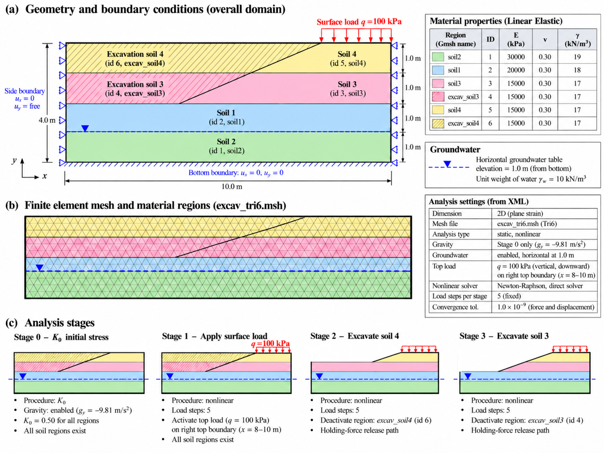
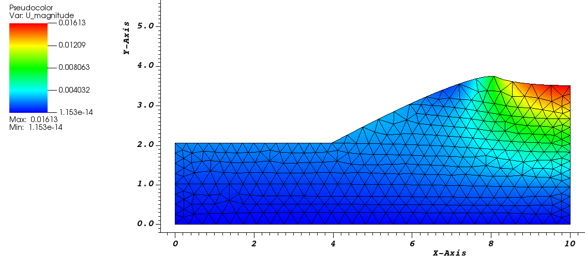
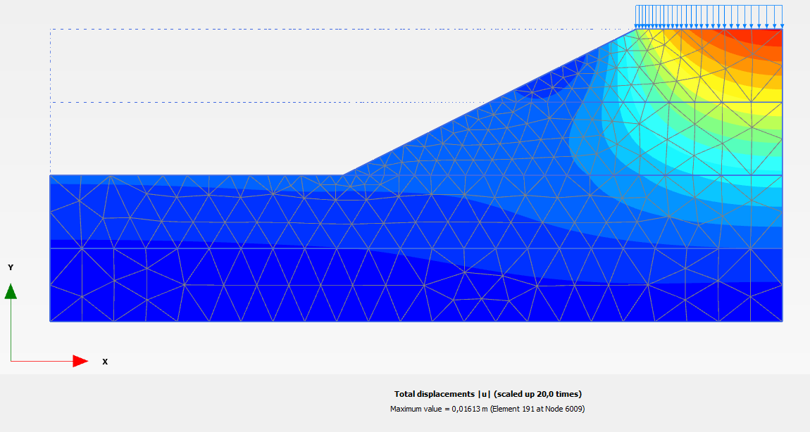

# Example — K₀ Initialization, Surface Loading, and Staged Excavation

This example demonstrates staged excavation in **GeoPyFEM** using a two-dimensional, plane-strain finite element model. It is intended to verify initial stress generation, surface loading, element deactivation, and equilibrium-preserving stress release during excavation.

## Case description

The model represents a **10.0 m × 4.0 m** soil domain with a staged excavation on its left-hand side and a **100 kPa downward surface load** applied along the top-right boundary (approximately `x = 8–10 m`). The bottom boundary is fixed in both directions (`u_x = u_y = 0`), while the side boundaries are restrained horizontally (`u_x = 0`) and free vertically. The sketch also shows a horizontal groundwater table at **elevation `y = 1.0 m`**, measured from the bottom boundary.



*Figure 1. Example 02 case description: (a) geometry and boundary conditions, (b) finite element mesh and material regions, and (c) analysis sequence from initial stress generation through two excavation stages.*

Six physical material regions are defined in the Gmsh mesh, including two regions that will be removed sequentially (`excav_soil4` and `excav_soil3`). All soils are modeled as **linear elastic** in this verification example, with material parameters shown in Figure 1. The analysis is two-dimensional **plane strain** and uses six-node triangular elements (Tri6).


## Example folder structure

All input files, images, and this README are stored directly under `examples/example02/`:

```text
examples/
└── example02/
    ├── README.md
    ├── case_description.png
    ├── visit_result.png
    ├── Plaxis_result.png
    ├── excavation.geo
    ├── excavation_k0_load_release.xml
    └── excav_tri6.msh
```

## Input files

- `excavation_k0_load_release.xml` — problem definition, material parameters, boundary conditions, loads, solver settings, and analysis stages.
- `excav_tri6.msh` — Gmsh mesh containing the six physical material regions and boundary groups.
- `excavation.geo` — Gmsh geometry source file, useful for viewing or modifying the original geometry and regenerating a mesh (if configured accordingly).

`case_description.png`, `visit_result.png`, and `Plaxis_result.png` are documentation images and do not need to be referenced by the XML file. The PLAXIS image provides an independent software comparison for the final excavation configuration.

The XML file references the mesh by its filename:

```xml
<Mesh>
  <File>excav_tri6.msh</File>
  <Format>gmsh</Format>
</Mesh>
```

Keep the mesh alongside the XML file when using GeoPyFEM's usual example-folder layout.

## How to run

1. Open a terminal and navigate to the **GeoPyFEM repository root** (the directory containing `main.py`):

   ```bash
   cd /path/to/geopyfem
   ```

2. Ensure Python and the GeoPyFEM dependencies are installed according to the repository's main README.

3. Run Example 02 using the XML file in its actual folder:

   ```bash
   python3 main.py examples/example02/excavation_k0_load_release.xml
   ```

   The XML input should refer to `excav_tri6.msh`. Both files are in `examples/example02/`.
   If your GeoPyFEM version resolves mesh paths relative to the working directory rather than the XML location, adjust the mesh path or working directory accordingly.

4. Inspect the terminal output to check that all stages converge. Do not assume convergence merely because the program started.

## Analysis sequence

| Stage | Operation | Key settings |
|---|---|---|
| **0** | Generate initial stresses | K₀ = 0.50 in all regions; gravity enabled, `g_y = -9.81 m/s²` |
| **1** | Apply surface traction | `t_y = -100 kPa` on the right-hand top boundary (`load`), 5 load steps |
| **2** | Excavate upper region | Deactivate `excav_soil4`, then release its temporary holding force over 5 load steps |
| **3** | Excavate lower region | Deactivate `excav_soil3`, then release its temporary holding force over 5 load steps |

The excavation stages use a **holding-force release path**: the temporary forces maintain equilibrium immediately after element deactivation and are progressively removed, allowing the remaining ground to deform and redistribute stresses. The XML selects fixed load stepping and a Newton–Raphson nonlinear solver (up to 20 iterations per step).

## Output and visualization

The XML enables VTK output:

```xml
<Output>
  <VTK enabled="true">
    <Directory>results</Directory>
    <BaseName>excavation_k0_load_release</BaseName>
    <WriteGaussPoints>true</WriteGaussPoints>
  </VTK>
  <Matplotlib enabled="false"/>
</Output>
```

After the run, locate the `results` directory produced by GeoPyFEM and open the stage VTK files in **VisIt** or **ParaView**. Inspect the displacement field, stress distribution, and remaining active elements after each excavation stage. In VisIt, an element-activity threshold can be used to hide excavated cells **if the VTK file contains an activity variable**.

For validation, confirm that both excavation regions initially exist, `excav_soil4` is absent after Stage 2, and `excav_soil3` is also absent after Stage 3. Inspect residual/convergence messages to confirm that the holding-force release stages converge.

### Deformation results (VisIt)

The following screenshot shows the **displacement magnitude** (`U_magnitude`) visualized in **VisIt** for the excavated slope configuration. The visible geometry corresponds to the ground remaining after both designated excavation regions have been removed.



*Figure 2. VisIt pseudocolor visualization of the GeoPyFEM displacement magnitude (`U_magnitude`) on the excavated mesh. The screenshot reports a maximum of approximately **0.01613 m (16.13 mm)**.*

The largest displacements are concentrated near the **upper-right part of the slope**, around the surface-loaded region, while smaller displacements appear in the deeper soil and toward the left boundary. The displayed variable is the **magnitude of displacement**, not the displacement direction. A pseudocolor result alone does not establish whether a geometric deformation scale was applied in VisIt.

This figure is a **visual result**, not a standalone numerical validation of the excavation algorithm. Quantitative validation additionally requires convergence checks and, ideally, comparison of nodal displacements or stress changes between analysis stages and against an independent solution.

### Benchmark comparison with PLAXIS

For an independent reference, the same staged-excavation example has also been analysed in **PLAXIS 2D**. The figure below displays the PLAXIS **total displacement magnitude** after excavation of the two designated regions. 



*Figure 3. PLAXIS 2D reference result for the excavated slope, showing total displacement magnitude |u|. The reported maximum displacement is 0.01613 m (16.13 mm), with the displayed deformation scaled by 20.0×.*

#### Maximum-displacement comparison

| Quantity | GeoPyFEM (VisIt) | PLAXIS 2D |
|:---|---:|---:|
| Displayed field | `U_magnitude` | Total displacements `|u|` |
| Maximum displacement | **0.01613 m** | **0.01613 m** |
| Maximum displacement (mm) | **16.13 mm** | **16.13 mm** |
| Difference of displayed maxima | — | **0.00 mm** |


The maximum displacement reported by GeoPyFEM **matches the PLAXIS value at the precision shown in the screenshots**. Both displacement plots also show the larger displacement zone near the top-right loaded area and smaller magnitudes toward the lower-left region of the remaining ground. This provides encouraging **benchmark agreement for the final-stage maximum displacement and the broad displacement pattern**.

**Scope of validation.** The two pictures alone cannot establish full numerical equivalence. In particular, the same-looking maximum values do not quantify node-by-node error, and the graphics may use different contour ranges or deformation display scales. Stronger validation would compare corresponding horizontal/vertical displacement components (`u_x`, `u_y`) at selected coordinates, stresses, and results after each stage; it would also verify that both models use equivalent material properties, groundwater elevation, boundary conditions, and excavation/load histories. These additional comparisons are not documented in the provided screenshots.

The XML's material densities correspond approximately to unit weights **19, 18, and 17 kN/m³**, using `γ = ρg / 1000` with `g = 9.81 m/s²`.
